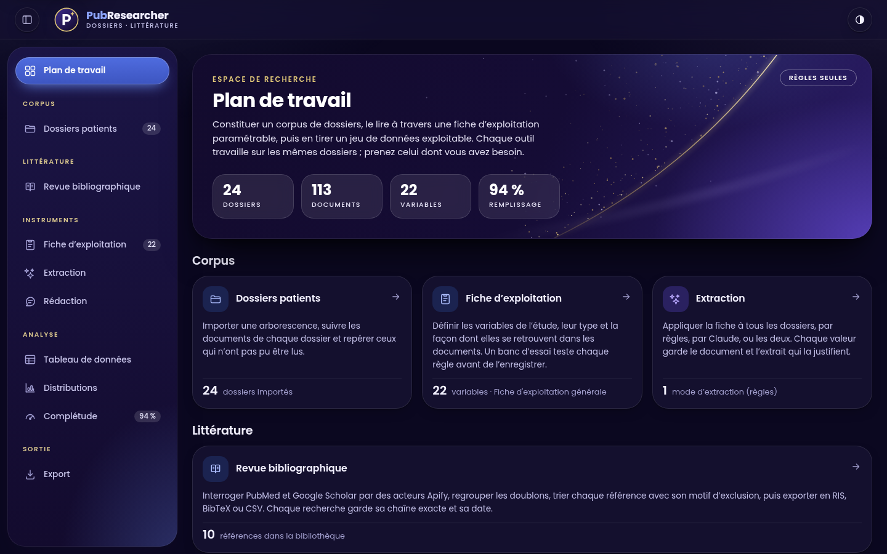

<p align="center">
  
</p>

# PubResearcher

L'espace de travail d'une étude rétrospective, sur votre poste. D'un côté, constituer un jeu de données de recherche à partir de dossiers patients hétérogènes : import des documents (Word, PDF — scannés compris —, images, DICOM, texte), extraction guidée par une **fiche d'exploitation paramétrable**, relecture traçable, mesure de fiabilité, visualisation, exports (CSV, Excel, diaporama) et rapport « Méthodes et traçabilité » prêt à citer. De l'autre, mener la **revue de littérature** : interroger PubMed et Google Scholar, trier chaque référence avec son motif, exporter en RIS, BibTeX ou CSV.

Pensée pour un travail de thèse ou une étude rétrospective : on part d'une pile de dossiers, on obtient un tableau exploitable dans Excel, R ou SPSS — sans ressaisir chaque variable à la main, et sans perdre la trace de l'origine de chaque valeur.

**Version 1.5.0** · Node.js ≥ 22.13 · un seul processus, aucun module natif à compiler · 828 tests

> **Données de santé.** Par défaut l'outil n'écoute que sur le poste et n'envoie **rien** hors de la machine. Il n'anonymise pas : importez des documents pseudonymisés. Avant tout import, l'application demande de **confirmer une charte d'anonymisation** (cinq engagements, rappelés à chaque nouvelle version du texte). Lisez [Sécurité et données](docs/securite-et-donnees.md) avant la première étude.

## Aperçu


| Thème sombre | Sur écran étroit |
|---|---|
|  |  |

**En vidéo** : [PubResearcher en 1 min 35](landing/public/video/presentation-pubresearcher.mp4) — l'application réelle, filmée sur les dossiers fictifs de la démonstration (import, charte d'anonymisation, extraction, relecture, résultats, export). Sans son, sous-titrée ; c'est celle que le site montre à la première inscription.

## Documentation

| Pour… | Lire |
|---|---|
| Utiliser l'outil, de la fiche à l'export | [Guide du chercheur](docs/guide-chercheur.md) |
| Installer, configurer, exposer, sauvegarder, dépanner | [Guide de l'administrateur](docs/guide-administrateur.md) |
| Rédiger la partie « Méthodes », mesurer la fiabilité, reproduire une extraction | [Méthodes et reproductibilité](docs/methodes-et-reproductibilite.md) |
| Savoir ce qui sort de la machine, le modèle de menaces, la liste de contrôle | [Sécurité et données personnelles](docs/securite-et-donnees.md) |
| Scripter l'outil (R, Python, `curl`) | [Référence de l'API](docs/reference-api.md) |
| Comprendre ou modifier le code | [Architecture](docs/architecture.md) |
| Savoir ce qui a été testé, et ce qui ne l'a pas été | [Rapport de validation](docs/validation.md) |
| Interroger PubMed et Google Scholar | [Revue bibliographique](docs/revue-bibliographique.md) |
| Mettre en ligne le site d'accueil (Supabase, Google, Vercel), comprendre la charte d'anonymisation | [Page d'accueil](docs/page-d-accueil.md) |
| Voir ce qui a changé | [Journal des versions](docs/changelog.md) |
| Connaître la charte graphique (couleurs, police, composants, accessibilité) | [Identité visuelle](docs/identite-visuelle.md) |

---

## Page d'accueil et charte d'anonymisation

Le dossier [`landing/`](landing/) contient le **site public** de l'outil, à déployer séparément de l'application (sur Vercel) : il la présente, propose de créer un accès (**Google** ou adresse e-mail), mène l'utilisateur dans un court parcours d'accueil — profil, étude, **engagement d'anonymisation avant d'importer des données de patients** — puis l'oriente vers l'application. L'application, de son côté, **redemande cet engagement avant tout import** : tant qu'il n'est pas pris, l'écran de dépôt des fichiers n'existe pas.

```bash
cd landing && npm ci && npm run dev      # http://localhost:5174 — « mode aperçu » : rien n'est envoyé ni conservé
```

Le site est une **porte d'entrée, pas une serrure** : il ne protège pas l'application, qui tourne sur le poste de l'utilisateur. Il ne reçoit aucune donnée de patient (seulement un profil professionnel et la trace de l'engagement pris). Mise en service pas à pas (Supabase, Google, Vercel), données conservées, limites : [Page d'accueil](docs/page-d-accueil.md).

---

## Ce que fait l'application

**1. Importer les dossiers.** Glissez une arborescence : chaque sous-dossier devient un dossier patient et son nom sert de code. Les documents sont analysés à l'import, chacun dans un fil séparé : un PDF piégé échoue seul.

| Format | Ce qui est exploité |
|---|---|
| PDF | Couche texte, lignes reconstituées par position ; **les pages scannées passent à l'OCR** |
| Word (`.docx`) | Texte et tableaux (les cellules restent appariées « libellé / valeur ») |
| Images (JPEG, PNG, TIFF) | Reconnaissance optique de texte (français, hors connexion) + date EXIF du cliché |
| DICOM (`.dcm`, sans extension) | Métadonnées : âge, sexe, modalité, date d'examen, paramètres d'acquisition |
| Texte, RTF, HTML | Encodage détecté (UTF-8, Windows-1252, UTF-16) |

Les doublons sont détectés par empreinte du contenu, pas par nom de fichier.

**2. Définir la fiche d'exploitation.** La liste des variables de votre étude, en sections. Chaque variable a un type (texte, nombre, entier, date, oui/non, choix unique, choix multiple), une unité, une définition, des bornes de plausibilité et — c'est le cœur — la façon dont elle se retrouve dans les documents.

**3. Extraire.** Une passe applique la fiche à tous les dossiers, par des **règles** que vous paramétrez, par **Claude**, ou par les deux. Chaque valeur trouvée conserve **le document et l'extrait qui la justifient** ; ce que les règles ont trouvé puis refusé (« CRP < 5 », « 85 µmol/L » pour du mg/L) est consigné avec sa raison (banc d'essai de la variable, bilan de la dernière passe).

**4. Relire.** Dossier par dossier, chaque variable affiche son origine (règle, Claude, relecture humaine), sa justification et son historique. Une valeur confirmée, corrigée ou vidée à la main **n'est jamais écrasée** par une extraction lancée depuis l'interface.

**5. Mesurer.** Les gestes de relecture donnent, sans rien saisir de plus, la **concordance** et le **rappel** de l'extraction avec leur intervalle de confiance à 95 %.

**6. Analyser et exporter.** Tableau de données, distributions, complétude ; CSV, classeur Excel typé, figures en diaporama, dictionnaire des variables, fiche JSON, journal d'audit, **rapport « Méthodes et traçabilité »** (français ou anglais) avec un paragraphe « Méthodes » rédigé à partir des chiffres de votre base.

**7. Faire la revue de littérature.** Une page à part, indépendante des dossiers : interroger PubMed et Google Scholar par des acteurs Apify, regrouper les doublons, trier chaque référence (retenue, à voir, exclue avec son motif), suivre le diagramme de flux et exporter en RIS, BibTeX ou CSV. [Détail](docs/revue-bibliographique.md).

---

## Démarrage

**Le plus simple.** Installez [Node.js](https://nodejs.org) (version « LTS », 22.13 ou plus récent), récupérez le projet (`git clone https://github.com/ridakodad/PubResearcher.git`, ou *Code › Download ZIP* sur GitHub, puis décompressez), puis double-cliquez sur **`lancer.bat`** (Windows) ou **`lancer.command`** (macOS ; sous Linux, `./lancer.command` dans un terminal). Le premier lancement installe les dépendances (environ 290 Mo, connexion internet nécessaire) et compile l'application, en deux minutes environ ; le navigateur s'ouvre ensuite sur http://localhost:4000. **Laissez la fenêtre ouverte** tant que vous travaillez : la fermer arrête l'outil. (Les lanceurs n'ont été essayés que sous Linux.)

**En ligne de commande**, depuis la racine du projet :

```bash
npm ci               # Node 22.13 ou plus récent ; « npm install » convient aussi
npm start            # compile à la première utilisation, puis sert http://localhost:4000
```

Après une mise à jour du code, recompilez explicitement (`npm run build`) : `npm start` ne compile que ce qui manque.

**Ça ne démarre pas ?**

| Ce que vous voyez | Cause | Remède |
|---|---|---|
| « Node.js n'est pas installé » ; « demande Node.js 22.13 ou plus récent » | Node absent, ou trop ancien | Installez la version « LTS » de [nodejs.org](https://nodejs.org), puis ouvrez une **nouvelle** fenêtre |
| La page ne s'ouvre pas : « connexion refusée », ou rien | L'outil tourne sur **une autre machine** (serveur, conteneur, ordinateur distant) alors que vous ouvrez `localhost` sur la vôtre ; il n'écoute que sur le poste où il est lancé | Lancez-le sur l'ordinateur dont vous vous servez, ou ouvrez-le au réseau : [guide de l'administrateur, § 5](docs/guide-administrateur.md#5-exposer-loutil-sur-un-réseau) (mot de passe obligatoire de fait) |
| « Le port 4000 est déjà occupé » ; « Ces données sont déjà utilisées par une autre instance » | Une autre fenêtre de l'outil est restée ouverte | Fermez-la (Ctrl+C), ou lancez une seconde instance sur un autre port et d'autres données : `PORT=4100 DATA_DIR=./data-2 npm start` |
| Windows, PowerShell : « l'exécution de scripts est désactivée sur ce système » | La stratégie d'exécution de PowerShell bloque `npm.ps1` | Double-cliquez sur `lancer.bat`, ou tapez les commandes dans l'**Invite de commandes** (`cmd`) plutôt que dans PowerShell |
| macOS : « ne peut pas être ouvert car il provient d'un développeur non identifié » | Protection du système pour un fichier téléchargé | Clic droit sur `lancer.command` › **Ouvrir**, puis confirmez (une seule fois) |
| L'installation (`npm ci`) échoue | Pas de connexion internet, ou un proxy d'établissement | Vérifiez la connexion ; derrière un proxy, configurez-le pour npm (`npm config set proxy …`) |
| « Cannot find module … dist/index.js » (archives livrées avant `lancer.bat`) | L'application n'a pas été compilée | `npm run build`, puis `npm start` |

Un téléphone ou une tablette ne peut pas faire fonctionner l'outil : il faut un ordinateur. Il n'existe pas de lien public à ouvrir : les données de patients ne doivent pas être exposées sur internet (voir [Sécurité et données](docs/securite-et-donnees.md)).

L'installation ne compile aucun module natif : le stockage s'appuie sur le module SQLite intégré à Node, donc ni chaîne de compilation C++ ni Visual Studio. Ce module est encore marqué expérimental par Node, qui affiche un avertissement au démarrage : il est sans conséquence. Sur un Node plus ancien que 22.13, l'outil s'arrête avec une phrase qui dit quoi installer.

L'outil écoute **sur le poste seulement** (`127.0.0.1`). Pour le partager, voir [le guide de l'administrateur](docs/guide-administrateur.md#5-exposer-loutil-sur-un-réseau) : mot de passe, HTTPS, noms d'hôte.

En développement (front et API séparés, rechargement à chaud) :

```bash
npm run dev          # front sur 5173, API sur 4000
```

Pour découvrir l'application avec des données factices :

```bash
npm run demo                 # écrit 24 dossiers dans data/demo/
npm run demo -- --upload     # les importe directement (l'application doit tourner)
```

Glissez `data/demo/` dans « Importer des dossiers », ou utilisez `--upload`, puis cliquez sur « Lancer l'extraction ».

Une fiche d'exploitation générale est fournie au premier démarrage (identité, antécédents, clinique, paraclinique, prise en charge, évolution — 22 variables). Elle est entièrement modifiable et sert surtout d'exemple de paramétrage.

---

## Les règles d'extraction

Une variable peut avoir plusieurs règles, évaluées **dans l'ordre** : la première qui produit une valeur conforme au type l'emporte, les suivantes servent de repli. Toutes les recherches ignorent la casse, les accents et les variantes d'apostrophe (droite ou typographique, celle de Word).

| Règle | Pour | Exemple |
|---|---|---|
| **Libellé suivi de la valeur** | La forme la plus courante | `Âge`, `Age du patient` → « Âge : 54 ans » → 54 |
| **Présence de mots-clés** | Un antécédent, un symptôme (avec négations et contextes à ignorer) | `diabète` / exclusions `pas de` → Oui / Non |
| **Expression régulière** | Ce que le libellé ne couvre pas | `patient de (\d{1,3}) ans` |
| **Tag DICOM** | Les métadonnées d'un examen | `PatientAge`, `Modality`, `00101010` |

Post-traitement : correspondances de valeurs (`CT = Scanner`), bornes de plausibilité, facteur de conversion. Le **banc d'essai** de l'éditeur teste une règle sur un texte collé ou un dossier réel, sans rien enregistrer.

Le moteur préfère un vide à une valeur fausse : une valeur seuil, un décimal pour un entier, une unité différente de celle de la variable, une valeur hors bornes sont **écartés et signalés**, jamais lus de travers. Détail, négations, mots entiers, limites : [guide du chercheur](docs/guide-chercheur.md#2-définir-la-fiche-dexploitation).

---

## Remplissage automatique par Claude

Les règles excellent sur ce qui est structuré. Elles atteignent leur limite sur le texte rédigé, où l'information n'est introduite par aucun libellé : *« patient de 54 ans adressé pour une dyspnée d'effort évoluant depuis six mois »*. C'est là que Claude prend le relais.

| Mode | Ce qu'il fait | Quand l'utiliser |
|---|---|---|
| **Règles seules** | N'applique que votre paramétrage | Par défaut. Gratuit, hors connexion, reproductible |
| **Règles puis Claude** | Les règles d'abord ; Claude ne reçoit que les variables restées vides | Le meilleur rapport coût/rendement |
| **Claude seul** | Soumet toute la fiche au modèle | Comparer, ou démarrer sans règles |

**Ce qui empêche une valeur inventée d'entrer dans le jeu de données** : deux contrôles indépendants. (1) Le modèle doit recopier un extrait du document ; cet extrait est **recherché dans le texte réel** du dossier — à défaut, c'est la valeur elle-même qui l'est (confiance plus basse) ; ni l'un ni l'autre, et la valeur est écartée. (2) La valeur passe ensuite par le même typage que celles des règles (type, options, bornes). L'extrait affiché en relecture est celui du document, pas celui du modèle. **Rien de ce qui vient d'un modèle ne devrait entrer dans une publication sans relecture humaine.**

> **Cette fonction envoie le texte des documents à l'API d'Anthropic**, sous les noms « Document 1 », « Document 2 »… (ni les noms de fichier ni le code du dossier ne partent, mais **le texte, lui, part tel quel**, nom du patient compris s'il y figure). C'est une sortie de données de santé hors de l'établissement : elle relève des mêmes autorisations que tout traitement externalisé, et se décide avant l'usage. Sans clé d'API, les deux modes « Claude » sont indisponibles. Le mode n'a pas été exercé contre l'API réelle dans la validation (le SDK l'a été contre un faux serveur ; voir le [rapport](docs/validation.md#11-limites-et-ce-qui-na-pas-été-vérifié)).

### Votre clé, votre facture

**Chacun utilise sa propre clé d'API Anthropic** : PubResearcher ne facture rien et ne revend pas d'IA ; ce que consomment Claude et l'assistant de rédaction est facturé directement sur votre compte Anthropic.

Personne ne se perd en chemin : la page **Activer Claude** de l'application (colonne de gauche) mène pas à pas, en mots simples, avec à chaque étape le lien direct vers la bonne page de la console d'Anthropic. Cinq minutes, une seule fois :

1. Créer son compte dans la [console d'Anthropic](https://platform.claude.com/) ;
2. y [acheter du crédit](https://platform.claude.com/settings/billing) — 5 $US suffisent pour essayer ; sans recharge automatique, on ne peut pas dépenser plus ;
3. y [créer la clé](https://platform.claude.com/settings/keys) (« Create key ») ;
4. la coller dans PubResearcher, qui la fait vérifier par Anthropic avant de l'enregistrer.

Le même guide est en ligne sur la page d'accueil (`/activer-claude`), pour préparer sa clé avant même d'installer l'outil. Une clé qui vaut pour plusieurs espaces de travail d'Anthropic est acceptée telle quelle : l'outil trouve seul l'espace par défaut. Ensuite, en mode « Règles puis Claude », l'écran affiche une **fourchette de coût en dollars** avant chaque passe, et le **coût réel** après.

La clé reste **sur la machine qui fait tourner l'outil**, dans `DATA_DIR/anthropic-key.json` (lisible du seul compte de service) : ni dans la base, ni dans les sauvegardes, ni dans les exports, et l'interface n'en montre plus que les quatre derniers caractères. « Retirer » l'efface.

Sur un serveur administré, la clé peut aussi venir de l'environnement ; celle saisie dans l'application l'emporte :

```bash
export ANTHROPIC_API_KEY=sk-ant-...    # Windows : setx ANTHROPIC_API_KEY sk-ant-...
npm start
```

| Variable | Défaut | Rôle |
|---|---|---|
| `ANTHROPIC_API_KEY` | — | Clé de secours, si aucune n'est saisie dans l'application |
| `ANTHROPIC_WORKSPACE_ID` | — | Espace de travail d'Anthropic à nommer avec cette clé de secours, si elle en couvre plusieurs (une clé saisie dans l'application le trouve seule) |
| `LLM_MODEL` | `claude-opus-5-5` | Modèle utilisé (Claude Opus 5.5 : 4 $US par million de jetons lus, 20 $US par million écrits). `claude-sonnet-5-5` coûte deux fois moins |
| `LLM_EFFORT` | `high` | Profondeur de raisonnement ; `medium` ou `low` réduisent le coût sur de grandes séries |
| `LLM_MAX_CHARS_PER_DOC` | `60000` | Texte transmis par document ; au-delà, tronqué et signalé au modèle |
| `LLM_MAX_TOKENS` | `16000` | Plafond de génération |

Un appel par dossier ; la consigne et le dictionnaire des variables sont mis en cache. Avec le modèle par défaut, un dossier ordinaire (une vingtaine de milliers de caractères, une trentaine de variables) coûte de l'ordre de **0,05 à 0,20 $US** ; l'estimation affichée avant chaque passe vaut pour votre corpus, la console d'Anthropic pour la facture. Commencez par quelques dossiers pour mesurer le coût et la qualité avant d'engager la cohorte entière.

---

## Export

- **Jeu de données (CSV)** — séparateur `;` (Excel français, virgule décimale) ou `,` (R, Python, SPSS, point décimal) ; oui/non en `1`/`0` ou `Oui`/`Non` ; en-têtes en clés techniques ou en libellés. UTF-8 avec marque d'ordre des octets pour que les accents s'affichent dans Excel. Les choix multiples occupent une colonne, options séparées par `|`.
- **Classeur Excel** — trois feuilles (données **typées**, dictionnaire, synthèse de cohorte).
- **Figures en diaporama** — une planche par variable décrite par un histogramme ou des modalités (pas pour le texte libre), en formes natives modifiables.
- **Dictionnaire des variables** — type, unité, options et définition. À joindre au jeu de données.
- **Rapport « Méthodes et traçabilité »** et **journal d'audit** — voir [Méthodes et reproductibilité](docs/methodes-et-reproductibilite.md).
- **Fiche au format JSON** — sauvegarde et partage du paramétrage ; réimportable depuis « Fiche d'exploitation ».

---

## Reconnaissance optique (OCR)

Photos, scans de comptes rendus **et pages scannées de PDF** passent par `tesseract.js` et les données de langue françaises, installées comme dépendances : **hors connexion**, sans téléchargement au premier usage (pour une autre langue, sans `OCR_LANG_PATH`, `tesseract.js` va chercher les données sur le réseau). Une page de PDF sans couche texte (moins de 20 caractères non blancs) est rendue en image puis lue, et le texte reconnu s'ajoute à celui qui existe ; les pages qui ont du texte ne sont pas touchées. Jusqu'à 30 pages par PDF (`OCR_MAX_PAGES`) : une page prend quelques secondes.

| Variable | Effet |
|---|---|
| `OCR_ENABLED=0` | Désactive l'OCR (import plus rapide) |
| `OCR_LANG` | Langue de reconnaissance, `fra` par défaut |
| `OCR_LANG_PATH` | Dossier de données de langue personnel |
| `OCR_MAX_PAGES`, `OCR_PDF_SCALE` | Pages d'un PDF passées à l'OCR (30), qualité du rendu (3) |

L'OCR se trompe : une lettre O lue comme un zéro (« 7O kg » donne 7), une négation perdue. Les valeurs venues d'un scan se relisent contre l'image ; l'écran « Dossiers patients » signale l'indisponibilité de l'OCR, et le détail d'un document indique quand aucun texte n'a pu être extrait ou qu'il vient d'un OCR.

---

## Identité visuelle

L'interface est un **plan de travail** : le rail d'outils présente en permanence tous les outils, groupés par nature du travail — constituer le corpus, régler les instruments, lire les résultats, sortir les données. Sur un écran étroit, il devient une pastille flottante au bas de l'écran, l'outil courant allumé.

La charte — indigo nuit, poussière d'or, bleu pervenche, police **Poppins** — est décrite dans [Identité visuelle](docs/identite-visuelle.md) : jetons de couleur, composants (carte d'en-tête, tuiles de chiffres, rail), thèmes clair et sombre. Chaque encre de texte tient au moins 4,5:1 de contraste sur chaque surface, et la bordure des champs de saisie 3:1, dans les deux thèmes (vérifié sur la feuille de style par un test automatique). Le rouge n'encode jamais de donnée (états critiques seulement) ; les graphiques n'ont qu'une série, en une teinte séquentielle bleue, pour rester lisibles sous déficience de vision des couleurs. Le thème clair ou sombre suit le système et se force depuis la barre supérieure ; toute animation s'efface si le système demande la sobriété.

La police est fournie avec l'application (`web/src/fonts/`, licence SIL OFL 1.1) : rien n'est téléchargé à l'exécution, l'outil démarre hors connexion.

---

## Configuration

Toute la configuration passe par des variables d'environnement. Les plus courantes :

| Variable | Défaut | Rôle |
|---|---|---|
| `PORT` | `4000` | Port d'écoute |
| `HOST` | `127.0.0.1` | Adresse d'écoute (`0.0.0.0` pour ouvrir au réseau — avec `APP_PASSWORD` et HTTPS) |
| `APP_PASSWORD` | — | Mot de passe d'accès (HTTP Basic) |
| `DATA_DIR` | `./data` | Base SQLite et fichiers importés |
| `ALLOWED_HOSTS`, `ALLOWED_ORIGINS`, `TRUST_PROXY` | — | Noms, origines et proxys de confiance (derrière un proxy inverse) |
| `MAX_UPLOAD_BYTES` | 200 Mo | Taille maximale d'un fichier |

**Liste complète** (plafonds d'analyse, isolation, OCR, Claude, Apify, diagnostic) : [guide de l'administrateur](docs/guide-administrateur.md#4-configuration). Une valeur numérique invalide arrête le démarrage, avec un message qui dit laquelle et la plage attendue.

Les documents importés sont conservés tels quels sous `DATA_DIR/uploads/`, sous un nom généré ; le nom d'origine reste affiché dans l'interface. **Sauvegarde** : `npm run backup` (voir [le guide](docs/guide-administrateur.md#6-sauvegarde-et-restauration)).

---

## Données personnelles

L'outil n'a ni chiffrement au repos ni comptes individuels : il est prévu pour un poste ou un serveur d'établissement maîtrisé, pas pour une exposition publique. Les documents et la base restent sur la machine qui l'héberge — **sauf** dans les modes « Claude » (texte des documents vers Anthropic), dans la rédaction assistée (des agrégats de la cohorte vers Anthropic) et dans la revue bibliographique (l'équation de recherche seule vers Apify). Ne transmettez que des documents **pseudonymisés** ; utilisez des codes de dossier sans lien avec l'identité : ils constituent la clé du jeu de données exporté. Modèle de menaces, protections, liste de contrôle d'avant-étude et conduite en cas d'incident : [Sécurité et données personnelles](docs/securite-et-donnees.md).

---

## Architecture

```
server/          API Node/TypeScript, SQLite (module intégré `node:sqlite`)
  src/extract/   Un extracteur par format, plafonds, OCR, analyse en fils séparés
  src/engine/    Repliage, typage, règles, expressions surveillées, passe d'extraction,
                 appel à Claude et vérification des citations
  src/biblio/    Revue bibliographique : client Apify, adaptateurs, exports RIS / BibTeX / CSV
  src/repo/      Accès aux données (dont fiabilité et rapport « Méthodes »)
  src/routes/    API HTTP
  test/          38 fichiers de test (dont la logique et la configuration de la page d'accueil)
web/             Interface React/TypeScript (Vite) : styles à la main, police et illustrations embarquées
landing/         Site public, déployé à part (Vercel) : présentation, inscription Google ou e-mail,
                 parcours d'accueil, charte d'anonymisation ; tables Supabase (migration), parcours e2e
scripts/         Démarrage (`ensure-build.mjs`) et génération de l'illustration d'en-tête
docs/            La documentation
```

En production, l'API sert aussi le front compilé : un seul processus, une seule origine. [Détail et décisions de conception](docs/architecture.md).

---

## Qualité

```bash
npm run typecheck
npm test             # 793 tests, un processus par fichier
cd landing && node --test e2e/flows.test.mjs   # 25 parcours de la page d'accueil (Playwright requis)
```

Les tests couvrent le moteur (repliage, typage, chaque famille de règles, négation, unités, expressions surveillées), la chaîne complète — import, extraction, relecture, export — sur de vrais fichiers PDF, DOCX, DICOM et images (PNG, JPEG avec EXIF, TIFF) construits par les fixtures, un **vrai processus serveur** (démarrage, verrou, réglages invalides, arrêt par signal), l'isolation sur de vrais fichiers piégés, le SDK d'Anthropic contre un faux serveur, et la revue bibliographique contre un faux serveur Apify qui rejoue de vraies sorties.

Le [rapport de validation](docs/validation.md) donne les mesures (banc d'essai du moteur, 97 fichiers hostiles, 25 arrêts brutaux, 1 000 à 5 000 dossiers, 64 combinaisons d'accessibilité, la suite sous cinq versions de Node — mesurées sur la 1.1.0, le moteur étant inchangé ; les § 1.2 à 1.5 disent ce qui a été rejoué pour les versions 1.2.0 à 1.5.0, le § 13 ce qui a été mesuré sur la page d'accueil) **et ce qui n'a pas été vérifié** : aucun corpus clinique réel, le mode « Claude » jamais exécuté contre l'API réelle, Excel et PowerPoint jamais ouverts, Chromium seulement.

`npm audit` (10 octobre 2026) : 3 avis modérés, dans la seule chaîne `mammoth` → `argparse` → `sprintf-js`, sans chemin atteignable avec une entrée utilisateur ; la « correction » proposée est un retour en arrière de `mammoth` — ne la lancez pas.
