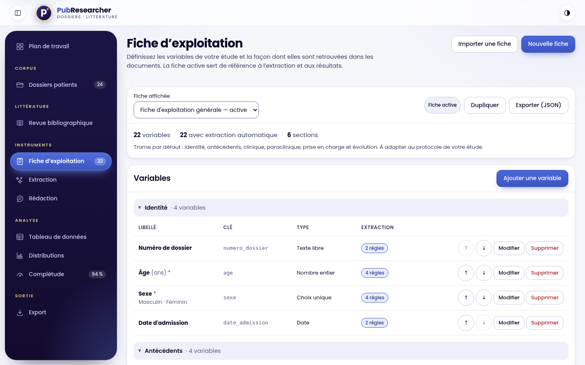
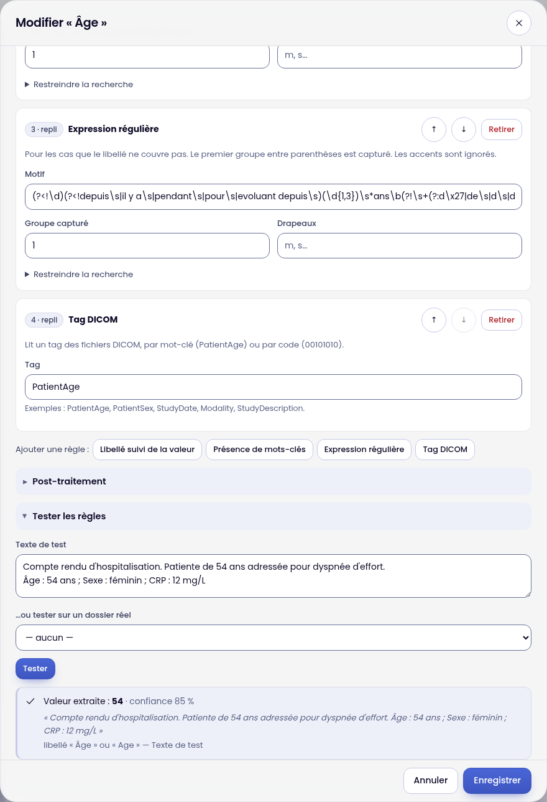
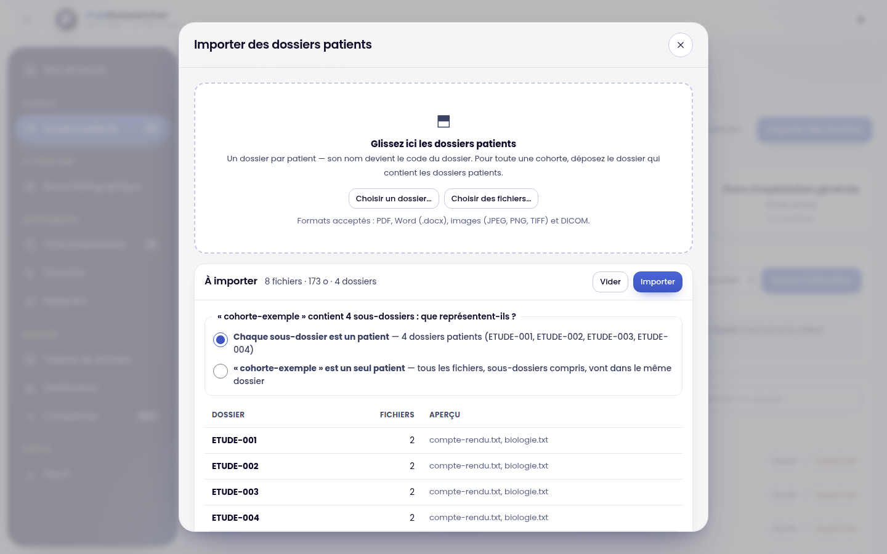
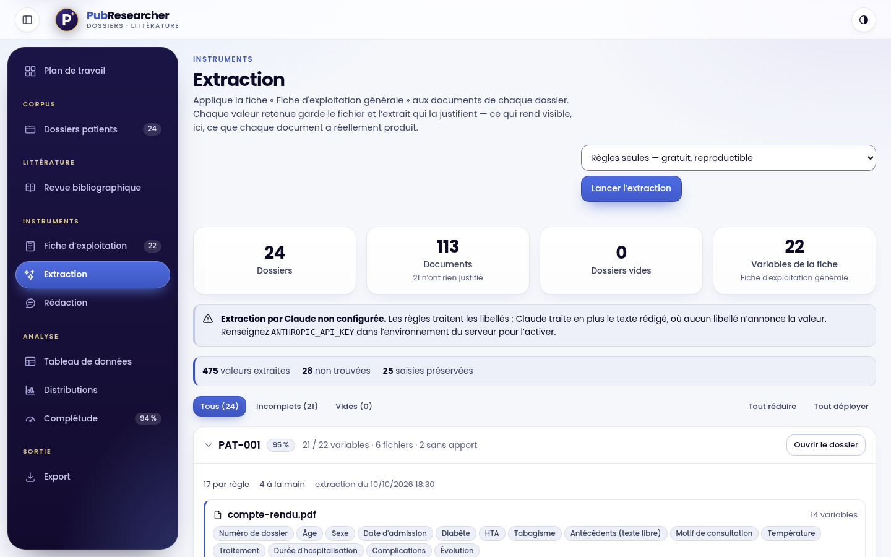
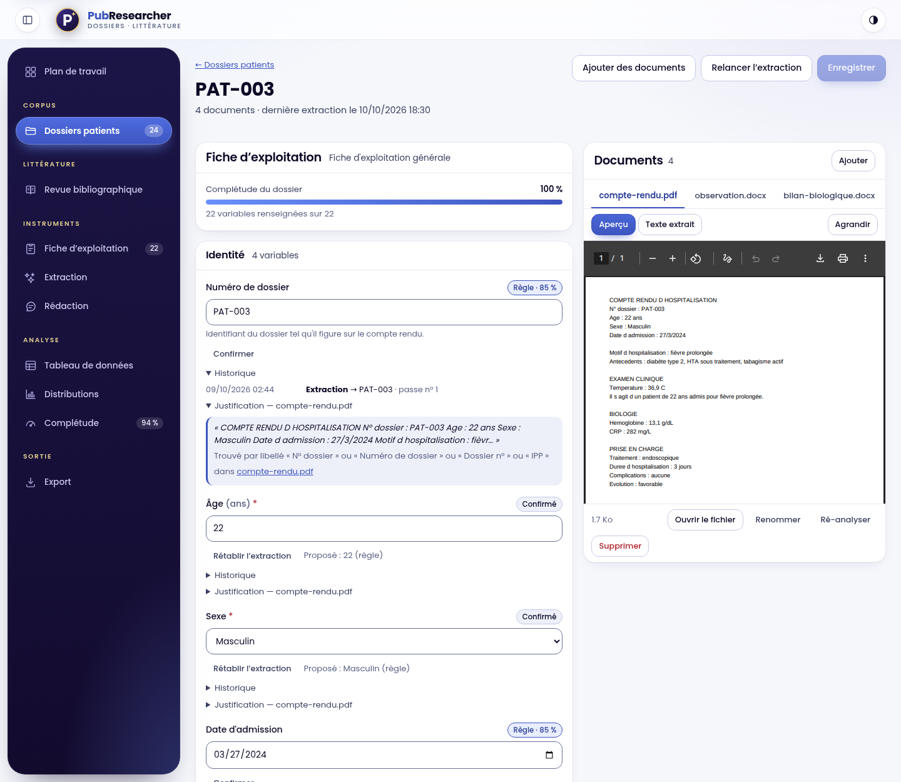
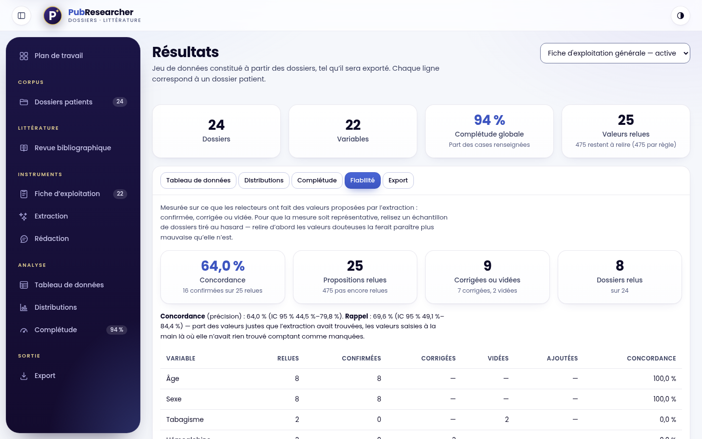
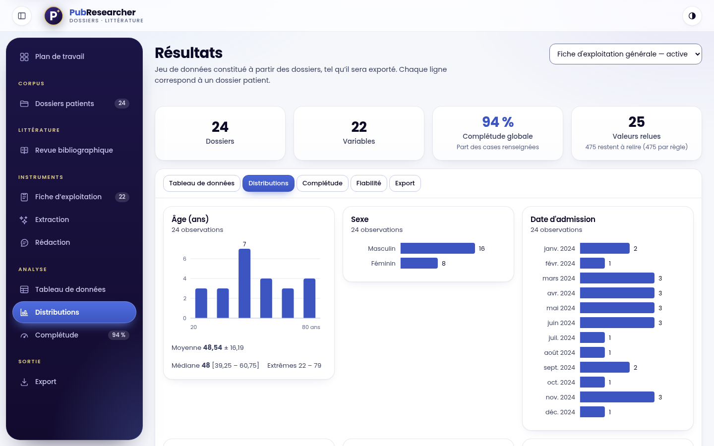
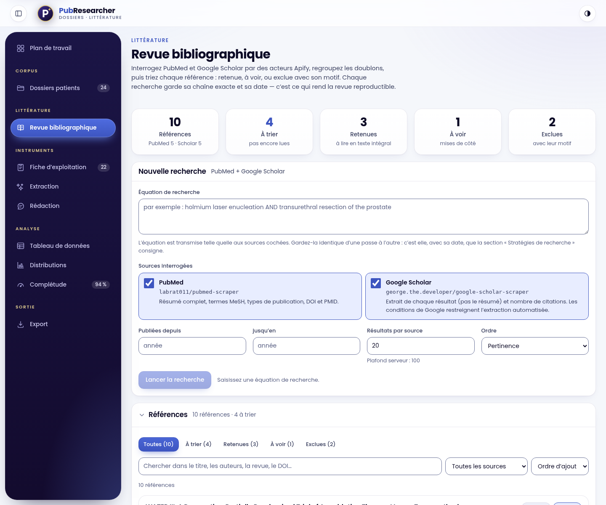

# Guide du chercheur

Ce guide s'adresse à qui doit construire un jeu de données à partir de dossiers patients hétérogènes (comptes rendus Word ou PDF, scans, images, examens DICOM) : un interne, un investigateur, un attaché de recherche clinique. Il suit l'ordre du travail réel. Pour installer l'outil, voir le [guide de l'administrateur](guide-administrateur.md) ; pour rédiger la partie « Méthodes » d'un article, voir [Méthodes et reproductibilité](methodes-et-reproductibilite.md).

> **Ce que l'outil fait.** Il lit des documents, applique une grille de variables que *vous* définissez, propose une valeur avec le passage qui la justifie, et garde la trace de tout ce que vous en faites.
> **Ce qu'il ne fait pas.** Il n'anonymise rien, ne remplace pas la relecture humaine, et ne lit que du texte : une donnée absente du texte (page non scannée, mention orale) ne peut pas être extraite.

> **Les captures** montrent les 24 dossiers fictifs de démonstration (`npm run demo`). La relecture y est **simulée** pour l'illustration : les pourcentages de fiabilité affichés ne mesurent pas l'outil.

---

## 1. Le parcours en sept étapes

| # | Étape | Où | Ce que vous obtenez |
|---|---|---|---|
| 1 | Définir la fiche d'exploitation | *Fiche d'exploitation* | La liste de vos variables et la façon de les retrouver |
| 2 | Importer les dossiers | *Dossiers patients* | Un dossier par patient, chaque document analysé |
| 3 | Contrôler l'import | *Dossiers patients*, *Extraction* | Les documents illisibles ou tronqués, repérés avant d'extraire |
| 4 | Extraire | *Dossiers patients* ou *Extraction* | Une valeur par variable, avec son justificatif |
| 5 | Relire un échantillon tiré au hasard | Détail d'un dossier | Les valeurs confirmées, corrigées ou vidées — et la mesure de fiabilité |
| 6 | Analyser | *Tableau de données*, *Distributions*, *Complétude*, *Fiabilité* | Effectifs, distributions, taux de remplissage |
| 7 | Exporter et documenter | *Export* | CSV, classeur Excel, figures, rapport « Méthodes et traçabilité » |

Le rail de gauche présente en permanence tous les outils, groupés par nature du travail (sur un écran étroit, c'est une barre flottante au bas de l'écran, qui défile : l'outil courant y reste en vue). La carte d'en-tête résume l'état du corpus ; la pastille en haut à droite dit si l'extraction par Claude est disponible (« Règles + Claude ») ou non (« Règles seules »). Aucun ordre n'est imposé : on peut revenir à la fiche après une première extraction, relancer une passe, importer d'autres dossiers. Les valeurs que vous avez relues ne sont jamais écrasées par une nouvelle passe (voir [étape 5](#6-relire)).

---

## 2. Définir la fiche d'exploitation

La fiche est la liste des variables de l'étude, regroupées en sections. Une fiche générale (identité, antécédents, clinique, paraclinique, prise en charge, évolution — 22 variables) est fournie au premier démarrage : utilisez-la comme exemple, **dupliquez-la** (*Dupliquer*) avant de la modifier, ou créez la vôtre (*Nouvelle fiche*). Une seule fiche est *active* à la fois (*Définir comme active*) ; c'est elle qui sert aux extractions, aux résultats et aux exports.

### 2.1 Une variable

| Champ | Rôle |
|---|---|
| **Libellé** | Le nom lisible, affiché partout |
| **Clé technique** | L'en-tête de colonne des exports. Lettres minuscules, chiffres et `_`, en commençant par une lettre (`age`, `crp_mg_l`). Unique dans la fiche |
| **Type** | Texte, nombre, entier, date, oui/non, choix unique, choix multiple |
| **Section** | Le regroupement affiché dans la relecture et les résultats |
| **Unité** | Affichée ; sert aussi à détecter une valeur exprimée dans une autre unité (voir 2.3) |
| **Définition** | Une phrase qui dit ce qu'on mesure. Elle part dans le dictionnaire des variables : un jeu de données sans définition n'est pas interprétable par un tiers |
| **Options** | Pour les choix unique et multiple : la liste fermée des valeurs possibles |
| **Obligatoire** | Signalé par une étoile en relecture |

Une variable porte au plus 30 règles ; une fiche importée compte au plus 500 variables.

### 2.2 Les règles d'extraction

Une variable peut avoir plusieurs règles. Elles sont évaluées **dans l'ordre**, document par document : la première qui produit une valeur conforme au type de la variable l'emporte ; les suivantes servent de repli. Une valeur trouvée mais inutilisable (« Âge : NR ») laisse la main à la règle suivante. Si aucune règle suivante ne produit de valeur, elle est consignée comme *valeur écartée*, avec sa raison : dans le banc d'essai de la variable, et sur la page *Extraction* dans le bilan de la dernière passe (« valeurs trouvées mais écartées »). Une règle suivante qui réussit efface ce rejet.

Les recherches ignorent la casse, les accents et les variantes d'apostrophe (l'apostrophe droite `'` et celle que Word insère, `’`) : `Durée d'hospitalisation` retrouve aussi bien `DUREE D HOSPITALISATION` que `Durée d’hospitalisation`, et un mot-clé `d'insuffisance rénale` trouve `d’insuffisance rénale`. Cela vaut pour les libellés, les mots-clés, les exclusions et les expressions régulières.

| Règle | À employer pour | Exemple |
|---|---|---|
| **Libellé suivi de la valeur** | La forme la plus courante d'un compte rendu | Libellés `Âge`, `Age du patient` → trouve « Âge : 54 ans » → 54 |
| **Présence de mots-clés** | Un antécédent, un symptôme : oui/non ou une étiquette | Termes `diabète`, `diabétique` ; exclusions `pas de`, `absence de` ; valeur `Oui` ; si nié `Non` |
| **Expression régulière** | Ce que le libellé ne couvre pas ; le premier groupe capturant est retenu | `patient de (\d{1,3}) ans` |
| **Tag DICOM** | Les métadonnées d'un examen, par mot-clé ou par code | `PatientAge`, `Modality`, `StudyDate`, `00101010` |

**Précisions sur le moteur**, utiles pour comprendre ce qu'il fait :

- **Mots entiers.** Un terme court (4 lettres ou moins : « hta », « irm », « mme ») ne se trouve que comme mot entier : « mme » n'est pas cherché dans « homme », « hta » n'est pas confondu avec « HTAP ». Un terme plus long peut être une racine volontaire (« diabet », « tabag »).
- **Négations.** Elles restent limitées à la proposition en cours : dans « pas de diabète, HTA sous traitement », le « pas de » ne contamine pas l'HTA. « ni » prolonge la négation (« pas de diabète, ni d'HTA » nie les deux). Une négation placée après le terme est lue aussi — **à condition que la règle déclare au moins un terme d'exclusion** (champ « Termes d'exclusion ») : « diabète : non », « diabète (-) », « HTA exclue » nient alors ; sans exclusion déclarée, ces formes **affirment** le diabète. En revanche « diabète non insulinodépendant » **affirme** le diabète.
- **Absence documentée ≠ donnée manquante.** Le champ « Valeur émise si le terme n'apparaît que nié » enregistre « Non » quand l'absence est écrite ; sans lui, la variable reste vide. Cette distinction compte à l'analyse.
- **Contextes à ignorer.** « Père diabétique » ne dit rien du patient : déclarez `père`, `mère`, `familial` comme contextes à ignorer, la mention n'est ni affirmée ni niée.
- **Valeurs seuil.** « CRP < 5 » n'est **pas** lu « 5 » : lire un seuil comme une mesure biaiserait toute moyenne. La valeur est écartée, affichée comme telle, et c'est à vous de trancher.
- **Entier et décimal.** Une variable entière qui rencontre « 3,5 » ne l'arrondit pas : elle l'écarte et le dit.
- **Libellé ou expression ?** La règle « libellé » s'arrête au point-virgule ou au saut de ligne et, pour une variable typée (nombre, date, oui/non, choix), à la fin de la phrase. Pour capturer un texte sur plusieurs lignes, employez une expression régulière.

### 2.3 Post-traitement

| Réglage | Effet |
|---|---|
| **Correspondances de valeurs** | Ramène une abréviation vers une option : `CT = Scanner`, `MR = IRM`, `H = Masculin` |
| **Minimum plausible** et **Maximum plausible** (variables numériques et entières) | Une valeur hors bornes est rejetée par l'extraction et la règle suivante prend le relais. C'est ce qui évite de lire « 120 ans d'évolution » comme un âge |
| **Facteur de conversion** | Multiplie la valeur trouvée (g/L → mg/L) |

Une **unité différente** de celle de la variable est détectée : « 6 mois » pour un âge en *ans*, « 85 µmol/L » pour une créatinine en *mg/L*, « 135 g/L » pour une hémoglobine en *g/dL* sont **écartés et signalés** (« unité « µmol/L » différente de « mg/L » »), jamais lus comme s'ils étaient dans la bonne unité. Le contrôle porte sur une liste fermée d'unités courantes (mg/L, g/L, µg/L, ng/L, ng/mL, pg/mL, µg/mL, mg/dL, g/dL, µg/dL, ng/dL, mmol/L, µmol/L, nmol/L, pmol/L, mEq/L, UI/L, UI/mL, %, mmHg, kg, g, mg, µg, cm, mm, m, mL, L, °C, °F) et sur les unités de temps ; une unité qu'il ne connaît pas, d'un côté ou de l'autre, ne bloque rien. Si vous déclarez un **facteur de conversion** (g/L → mg/L), c'est que vous prenez la conversion en charge : le contrôle des unités courantes est levé pour cette variable (celui des unités de temps reste actif). Les bornes servent aussi à la saisie manuelle : une valeur hors bornes demande une confirmation explicite.

### 2.4 Tester avant d'enregistrer

Dans l'éditeur d'une variable, **Tester les règles** évalue le paramétrage sans rien enregistrer, sur un texte collé ou sur un dossier réel : valeur extraite, confiance, extrait justificatif — et, si rien n'est retenu, les valeurs trouvées puis écartées, avec la raison. Le banc applique l'unité de la variable comme une passe : « CRP : 85 µmol/L » pour une variable en mg/L y est écarté de la même façon. Itérez ici plutôt que par une passe complète.

### 2.5 Sauvegarder et partager la fiche

*Export › Fiche au format JSON* écrit la fiche complète ; *Importer une fiche* la recrée sur un autre poste ou pour une autre étude, **en entier ou pas du tout**. Gardez ce fichier avec le protocole de l'étude : il définit ce qui a été extrait.

Chaque passe d'extraction enregistre l'**empreinte** (SHA-256) des règles de la fiche. Deux passes d'empreinte identique ont appliqué exactement les mêmes règles ; si l'empreinte change entre deux passes, la fiche a été modifiée entre-temps — le rapport « Méthodes et traçabilité » le montre.

---

## 3. Importer les dossiers

*Dossiers patients › Importer des dossiers*, puis déposez un dossier ou des fichiers.

**D'abord, la charte d'anonymisation.** La première fois — et à chaque nouvelle version du texte —, la fenêtre d'import affiche, à la place de la zone de dépôt, « Avant d'importer des données de patients » : *PubResearcher n'anonymise rien*, puis cinq engagements à cocher : identifiants directs retirés ; endroits que l'on oublie vérifiés (en-têtes et pieds de page, tampons, noms de fichiers, texte incrusté dans les scans, balises DICOM) ; un code d'étude sans lien avec l'identité, la table de correspondance gardée ailleurs ; la base légale et les autorisations ; pas de mode « Claude » sans autorisation, et aucune donnée de patient dans une équation de recherche. **« Je confirme et je continue »** ne s'active qu'une fois les cinq cochés. L'engagement est retenu dans ce navigateur ; ensuite, une ligne de rappel reste au-dessus de la zone de dépôt (« Revoir mes engagements » les déplie). Cocher ne vérifie rien — l'outil ne sait pas si un document est anonymisé : c'est à faire **avant**, voir la [liste de contrôle](securite-et-donnees.md#6-avant-de-démarrer-une-étude--liste-de-contrôle). Si votre établissement a mis en ligne la [page d'accueil](page-d-accueil.md) de l'outil, l'engagement que vous y avez pris porte sur le même texte.

| Format | Ce qui est exploité |
|---|---|
| PDF | Couche texte, lignes reconstituées par position. Une page sans texte (scan) passe à l'OCR |
| Word (`.docx`) | Texte et tableaux ; les cellules restent appariées « libellé / valeur » |
| Images (JPEG, PNG, TIFF) | Reconnaissance optique de texte (français, hors connexion) et date EXIF du cliché |
| DICOM (`.dcm`, ou sans extension) | Métadonnées : âge, sexe, modalité, date d'examen, paramètres d'acquisition |
| Texte, RTF, HTML | Encodage détecté (UTF-8, Windows-1252, UTF-16) |

**Un dossier déposé = un patient, et son nom sert de code.** Si vous déposez un dossier qui en contient plusieurs (une cohorte), l'écran le détecte et vous laisse choisir entre « Chaque sous-dossier est un patient » (par défaut) et « « nom du dossier » est un seul patient » : fusionner vingt patients sous un seul code mélangerait leurs données sans que rien ne le signale. Des fichiers déposés sans dossier demandent un code, que vous saisissez.

Les codes sont normalisés : les caractères invisibles (copiés depuis un tableur ou un PDF) sont retirés, les espaces typographiques deviennent des espaces ordinaires, les suites d'espaces sont réduites à une et les espaces de bord coupés ; « PAT-001 » et « pat-001 » désignent le même dossier. **Utilisez des codes pseudonymisés** : le code est la clé du jeu de données exporté.

Les **doublons** sont reconnus par l'empreinte du contenu, pas par le nom : un fichier identique déjà importé dans le même dossier est signalé et ignoré.

| Limite | Valeur par défaut | Réglable par l'administrateur |
|---|---|---|
| Taille d'un fichier | 200 Mo | oui |
| Taille d'un envoi | 2 Go | oui |
| Fichiers par envoi | 200 (l'écran en envoie 25 à la fois) | non |
| Pages lues par PDF | 1 500 | oui |
| Pages d'un PDF passées à l'OCR | 30 | oui |
| Texte conservé par document | 8 millions de caractères | oui |

Quand une limite de **lecture** est atteinte (pages, délai, texte), le document est importé **et le dit** : à la fin de l'import, un bandeau « Importés, mais lus en partie » liste les fichiers concernés (« Texte tronqué : … », « Lecture partielle : N pages non lues … »), et la visionneuse du document affiche « Lecture incomplète » ; ces documents sont comptés dans le rapport « Méthodes » comme *lus partiellement*. Quand une limite de **taille** est dépassée (fichier, envoi), le serveur refuse l'envoi (413) : l'écran renvoie alors les fichiers du lot un par un, de sorte que seul le fichier trop gros est signalé en erreur. Un fichier illisible n'empêche jamais d'importer les autres.

Sur un document déjà importé : **Renommer** (l'extension ne change pas), **Ré-analyser** (après activation de l'OCR, par exemple), **Supprimer**. **Supprimer un dossier supprime aussi ses fichiers sur le disque** : c'est irréversible.

---

## 4. Contrôler l'import

Avant d'extraire, deux minutes évitent des heures de doute :

- *Dossiers patients* indique, par dossier, l'état de l'analyse ; un dossier dont des documents n'ont donné aucun texte affiche « N sans texte », et le total figure en tête de page.
- Dans le détail d'un dossier, **Texte extrait** montre ce que le moteur *lit réellement* : c'est ce texte, pas l'aspect du PDF, qui est interrogé. Un scan de mauvaise qualité donne un texte truffé d'erreurs (un « O » lu comme un zéro) ; les valeurs qui en viennent se relisent contre l'image.
- *Extraction* liste, après une passe, les **documents qui n'ont rien produit** : un compte rendu dont aucune règle n'accroche le vocabulaire, un document sans texte exploitable. Le paramétrage se corrige à partir de là, pas à partir d'un pourcentage global.

---

## 5. Extraire

*Dossiers patients › Extraction automatique*, ou la page *Extraction*. Choisissez le **moteur**, puis *Lancer l'extraction* : la passe couvre tous les dossiers. Depuis le détail d'un dossier, *Relancer l'extraction* ne traite que celui-ci, **toujours en mode « Règles seules »**, quel que soit le moteur choisi ailleurs.

| Moteur | Ce qu'il fait | Quand l'utiliser |
|---|---|---|
| **Règles seules** | N'applique que votre paramétrage | Par défaut. Gratuit, hors connexion, reproductible |
| **Règles puis Claude** | Les règles d'abord ; le modèle ne reçoit que les variables restées vides | Meilleur rapport coût/rendement |
| **Claude seul** | Soumet toute la fiche au modèle | Comparer, ou démarrer sans règles |

> **Données de santé.** Les modes « Règles puis Claude » et « Claude seul » **envoient le texte des documents** à l'API d'Anthropic (sous les noms « Document 1 », « Document 2 »… : ni les noms de fichier ni le code du dossier ne partent, mais le texte, lui, part tel quel). Cette sortie de données relève des mêmes autorisations que tout traitement externalisé de données de santé, et se décide avant l'usage. Le mode « Règles seules » n'en envoie aucune. Sans clé d'API, les deux autres modes sont indisponibles. Voir [Sécurité et données](securite-et-donnees.md).

**Votre clé d'API Anthropic.** Les modes « Claude » et la rédaction assistée utilisent **votre** clé : vous payez Anthropic directement, à l'usage, et PubResearcher ne facture rien. Une seule fois :

1. créez une clé dans la [console d'Anthropic](https://console.anthropic.com/settings/keys) (compte gratuit, puis crédit prépayé) et **fixez-y une limite de dépenses mensuelle** : c'est votre garde-fou ;
2. sur la page *Extraction*, panneau **Clé d'API Anthropic**, collez-la (elle commence par « sk-ant- ») puis *Vérifier et enregistrer*. L'outil la fait vérifier par Anthropic avant de l'enregistrer : une clé erronée, désactivée ou sans crédit est refusée avec la raison, et rien n'est gardé.

Elle reste sur l'ordinateur qui fait tourner l'outil, hors de la base, des sauvegardes et des exports ; l'écran n'en montre plus que les quatre derniers caractères. *Changer de clé* la remplace, *Retirer* l'efface. Si votre administrateur a fourni une clé pour le serveur, le panneau l'indique (« Clé fournie par le serveur ») et *Utiliser ma propre clé* la remplace par la vôtre.

**Ce que coûte une passe.** Dès qu'un mode « Claude » est choisi, la page affiche une **fourchette en dollars** pour tous les dossiers, calculée sur leur texte réel ; au-delà de 5 $US, l'outil demande confirmation avant de lancer. Le bilan de passe donne ensuite le **coût constaté**, d'après les jetons facturés. Avec le modèle par défaut (Claude Opus 5.5), un dossier ordinaire coûte de l'ordre de 0,05 à 0,20 $US. En mode « Règles puis Claude », seules les variables restées vides partent : la passe coûte moins que le haut de la fourchette.

Le **bilan de passe** s'affiche à la fin de la passe (pages *Extraction* et *Dossiers patients*) avec les totaux : variables extraites, non trouvées, gardées (déjà relues par un humain), **écartées** (valeur trouvée mais inutilisable : seuil, hors bornes, unité, type) et, pour le modèle, valeurs non vérifiées ou invalides. Sur la page *Extraction*, la liste des valeurs écartées (dossier, variable, extrait, raison) se déplie sous les totaux ; elle ne vaut que pour la dernière passe, tant que la page reste ouverte. Le détail par dossier et par variable est dans la réponse de l'API (`reports`). Ces chiffres renseignent la qualité des documents autant que celle des règles.

Ce qu'il faut savoir d'une passe :

- **Elle est reproductible** : même fiche, mêmes documents, mêmes valeurs (mode « Règles seules »).
- **Elle ne détruit pas votre relecture.** Une valeur confirmée, corrigée ou vidée à la main est gardée. (L'API permet d'écraser aussi les valeurs relues, `overwriteManual`, pour repartir de zéro ; l'interface ne l'expose volontairement pas.)
- **Elle est journalisée** : fiche (empreinte), mode, modèle éventuel, dates, effectifs. Une variable qui n'est *plus* trouvée perd sa valeur automatique au lieu de la conserver en silence, et l'événement est consigné — mais une passe ne retire que ce qu'elle a pu produire : « Règles seules » ne touche pas aux valeurs de Claude, et un appel au modèle en échec (limite de débit, panne) n'efface rien.
- **Elle est atomique par dossier** : un arrêt brutal du serveur en plein milieu laisse chaque fiche telle qu'elle était, jamais à moitié effacée.
- **Avec un modèle** : une valeur proposée n'est retenue que si la citation recopiée du document est *retrouvée* dans son texte — ou, à défaut, si la valeur elle-même y figure (quatre caractères au moins ; confiance plus basse, 75 % au lieu de 90 %) —, puis si elle passe le même contrôle de type et de bornes que les règles. Retrouver la valeur ne prouve pas qu'elle a été lue à cet endroit. Elle est marquée « Claude » et demande une relecture plus attentive qu'une valeur de règle. Commencez par quelques dossiers pour mesurer coût et qualité.

---

## 6. Relire

Ouvrez un dossier (*Dossiers patients › Ouvrir*). Chaque variable affiche sa **valeur**, son **origine** (étiquette) et, dépliable, sa **justification** : le passage du document cité, avec la règle qui l'a trouvé et un lien vers le document : pour un texte, le passage est surligné ; pour un PDF ou une image, l'aperçu s'ouvre sans positionnement, la citation s'affiche au-dessus, et le bouton « Situer dans le texte » la surligne dans le texte extrait.

| Étiquette | Signification |
|---|---|
| **Règle · 85 %** | Valeur proposée par une règle, avec sa confiance *relative* (voir ci-dessous) — non relue |
| **Claude · 90 %** | Valeur proposée par le modèle, citation retrouvée (75 % si seule la valeur l'a été) — non relue |
| **Confirmé** | Un relecteur a validé la proposition telle quelle |
| **Corrigé** | Un relecteur l'a remplacée (« Proposé : 282 (règle) » reste affiché) |
| **Vidé** | Un relecteur a écarté la proposition : la case reste vide aux passes suivantes |
| **Saisi** | Valeur entrée à la main là où l'extraction n'avait rien trouvé |
| **Vérifié · vide** | Relu : il n'y a rien à relever dans le dossier |
| **Non renseigné** | Ni valeur ni relecture |
| **Modifié** | Correction saisie, pas encore enregistrée |

Les gestes :

- **Confirmer** valide la valeur proposée, sans la ressaisir.
- **Corriger** : saisissez la bonne valeur. Les contrôles sont ceux du type (un entier n'accepte pas « 3,5 », une date doit exister au calendrier — pas de 31 février —, un choix doit être une option). Les nombres s'écrivent avec la virgule ou le point. Une valeur **hors des bornes de plausibilité** ouvre la fenêtre « Valeur inhabituelle » : *Corriger*, ou *Enregistrer quand même* si elle est extraordinaire mais vraie.
- **Vider** une valeur : effacez le champ. Une absence relue est une information.
- **Rétablir l'extraction** retire votre décision **et relance aussitôt l'extraction de ce dossier**, en mode « Règles seules » : la variable est de nouveau remplie par les règles si elles la retrouvent, et reste vide sinon. Les valeurs « Claude » des *autres* variables ne sont pas touchées (une passe de règles ne retire que ce que des règles ont posé).
- **Historique** liste, pour la variable, chaque événement, du plus récent au plus ancien : chaque décision de relecteur puis la passe qui avait posé la valeur, avec l'ancienne et la nouvelle valeur.
- Les corrections s'accumulent dans une barre en bas de l'écran ; **Enregistrer (Ctrl+S)** les valide d'un coup, **Annuler les corrections** les abandonne.

> **La « confiance » n'est pas une probabilité.** Elle est fixée par la famille de la règle (DICOM 95 %, libellé 85 %, expression régulière 80 %, mot-clé 70 % — une fiche importée en JSON peut en fixer une par règle) et diminue de 3 points par rang de règle de repli. Elle sert à ordonner la relecture, pas à estimer une exactitude. La seule mesure d'exactitude valable est celle de la page *Fiabilité*.

### Tirer l'échantillon de relecture au hasard

Chaque geste de relecture est compté. La page *Fiabilité* en déduit :

- la **concordance** (précision) : parmi les valeurs proposées *et relues*, la part confirmée telle quelle ;
- le **rappel** : parmi les valeurs justes selon les relecteurs, la part que l'extraction avait trouvée ;
- leur **intervalle de confiance à 95 %** (méthode de Wilson) : le rappel et les intervalles s'affichent pour l'ensemble ; par variable, le tableau donne la concordance (intervalle en infobulle) ; le détail complet par variable (rappel compris) est dans l'export JSON du rapport « Méthodes » et dans l'API.

**Ces mesures ne valent que si les dossiers relus sont tirés au hasard.** Relire d'abord les valeurs douteuses fait baisser la concordance affichée ; relire d'abord les dossiers faciles la fait monter. Pour une estimation défendable : tirez 10 à 20 % des dossiers au hasard (une liste de nombres aléatoires suffit), relisez-les *en entier*, ne choisissez pas.

---

## 7. Analyser

Quatre vues dans la page *Résultats* (trois sont aussi dans le rail ; *Fiabilité* n'est qu'un onglet de *Résultats*) :

| Vue | Contenu |
|---|---|
| **Tableau de données** | Un dossier par ligne, une variable par colonne, avec l'origine de chaque valeur (règle, modèle, relue). Recherche et pagination |
| **Distributions** | Histogramme pour le quantitatif (moyenne, écart type, médiane, extrêmes), effectifs pour le qualitatif, chronologie pour les dates. Les manquants sont comptés à part |
| **Complétude** | Taux de remplissage par variable, partagé entre automatique, modèle, relu et vide : où porter l'effort de relecture |
| **Fiabilité** | Concordance et rappel globaux avec leurs intervalles ; concordance par variable (intervalle en infobulle) |

Les valeurs vides restent **vides** dans les distributions : une variable à 40 % de manquants n'affiche pas 100 % de « Non ».

---

## 8. Exporter et documenter

*Export* propose les sorties suivantes (boutons entre guillemets) :

| Sortie | Pour qui, pour quoi |
|---|---|
| **« Télécharger le CSV »** | Séparateur `;` (Excel français, virgule décimale) ou `,` (R, Python, SPSS, point décimal) ; oui/non en `1`/`0` ou `Oui`/`Non` ; en-têtes en clés techniques ou en libellés. UTF-8 avec marque d'ordre des octets : Excel affiche les accents |
| **« Télécharger le classeur »** (Excel) | Trois feuilles : les données **typées** (les dates restent des dates, les nombres des nombres), le dictionnaire des variables, une synthèse de cohorte |
| **« Dictionnaire des variables »** | Clé, libellé, section, type, unité, obligatoire, options, définition, libellé du type. À joindre à tout jeu de données diffusé |
| **« Télécharger les figures »** (diaporama) | Une planche par variable décrite par un histogramme ou des modalités (pas de planche pour le texte libre ni pour une variable sans valeur), graphiques en formes natives modifiables, numérotées et citables |
| **« Rapport (HTML) », « Markdown », « English »** | Le rapport « Méthodes et traçabilité » : corpus, fiche (empreinte), passes, origine des valeurs, fiabilité, journal, environnement logiciel, limites. L'écran propose le HTML et le Markdown en français, et le Markdown en anglais ; le JSON et le HTML anglais s'obtiennent par l'API (`/api/export/methods?format=json&lang=en`) |
| **« Journal des modifications (CSV) »** | Chaque changement de valeur : horodatage, dossier, variable, avant/après, origine, passe — **pas l'auteur** (l'outil n'a pas de comptes). Ordre chronologique ; aucune fonction ne modifie le journal, mais il disparaît avec le dossier qu'on supprime |
| **« Fiche au format JSON »** | Le paramétrage, réimportable |

Le CSV, le classeur et le diaporama **ne portent pas l'origine** des valeurs (règle, modèle, relecteur) : elle reste dans le tableau de données de l'écran, dans le journal et dans le rapport « Méthodes ». Mentionnez dans votre article la part de valeurs relues, que le rapport calcule.

Le rapport contient un **paragraphe « Méthodes » prêt à adapter**, rédigé avec les chiffres de votre base. Voir [Méthodes et reproductibilité](methodes-et-reproductibilite.md).

---

## 9. Revue bibliographique

*Littérature › Revue bibliographique*. Cette page est indépendante des dossiers patients : elle a ses propres tables et ne lit aucune donnée de patient.

1. **Rechercher.** Une équation, transmise telle quelle à PubMed et/ou Google Scholar (acteurs Apify, facturés au résultat, appelés *par le serveur*) ; période, ordre, nombre de résultats par source. L'administrateur doit avoir renseigné `APIFY_TOKEN`. Sans lui, la page reste consultable (bibliothèque, tri, exports) mais aucune recherche ne part.
2. **Regrouper.** Un article trouvé deux fois devient une référence (DOI, puis PMID, puis PMCID, puis titre normalisé). Rien n'est effacé.
3. **Trier.** *Retenir*, *À voir*, *Exclure…* ; l'exclusion exige son **motif** (population, intervention, critère de jugement, schéma d'étude, langue, texte intégral introuvable, doublon de publication, autre). Rien ne se supprime.
4. **Suivre le diagramme de flux** inspiré de PRISMA 2020 : identifiées, doublons retirés, à trier, exclues par motif, retenues. Tous les chiffres sont calculés, aucun n'est saisi.
5. **Consigner les stratégies** : chaque passe, réussie ou non, garde son équation, sa date, l'acteur, la période, les effectifs. « Reprendre » recharge une passe dans le formulaire sans rien relancer.
6. **Exporter** en RIS (Zotero, EndNote, Mendeley), BibTeX ou CSV, et le CSV des stratégies.

À savoir : Google Scholar n'autorise pas l'extraction automatisée (conditions d'utilisation) ; pour une revue systématique, **PubMed est la source de référence**. Le plan gratuit d'Apify limite l'acteur PubMed à 10 résultats par passe. Scholar ne donne qu'un *extrait*, pas le résumé. **N'écrivez aucune donnée de patient dans l'équation** : seule l'équation part chez Apify.

---

## 10. Rédaction assistée

*Instruments › Rédaction* est un assistant qui aide à rédiger les sections d'un article à partir des **agrégats** de votre cohorte (effectifs, indicateurs et modalités de chaque variable, définitions ; une variable en texte libre ne donne que ses effectifs) — jamais une ligne de patient, un code de dossier ou un nom de fichier. Ces agrégats partent à l'API d'Anthropic (voir [Sécurité et données](securite-et-donnees.md)). Il est indisponible sans clé API. Il n'invente pas de chiffre : relisez tout ce qu'il écrit et vérifiez chaque nombre contre le tableau de données.

---

## 11. Limites à connaître

- **Le moteur lit du texte.** Un document illisible, une page non scannée, une mention orale ne produisent rien ; l'absence d'une valeur n'établit pas que la donnée n'existe pas.
- **L'OCR se trompe.** Un « O » peut être lu comme un zéro (« 7O kg » donne 7), une négation peut se perdre. Les valeurs venues d'un scan se relisent contre l'image.
- **Le français d'abord.** Négations, sigles et libellés sont pensés pour des comptes rendus en français ; d'autres langues demandent de réécrire les règles.
- **La confiance n'est pas une probabilité** (voir plus haut).
- **Les années à deux chiffres** (« 12/03/21 ») sont lues avec l'année courante comme pivot (au-delà, c'est le siècle précédent : « 45 » donne 1945 en 2026). Pour une date de naissance, vérifiez le siècle ; le même document peut se lire autrement dans quelques années.
- **Une fiche à la fois, un poste à la fois.** Deux onglets qui modifient le même dossier ne se préviennent pas : la dernière écriture l'emporte. Travaillez à un seul endroit, ou un seul relecteur par dossier.
- **Le mode « Claude » n'a pas été éprouvé contre l'API réelle** dans la validation de cette version (voir le [rapport de validation](validation.md)) : le SDK est exercé contre un faux serveur, et la vérification des citations et du typage est testée.
- **Des mesures de fiabilité sur un petit échantillon sont très larges** : regardez l'intervalle de confiance, pas seulement le pourcentage.

---

## 12. Aide-mémoire : messages fréquents

| Message | Que faire |
|---|---|
| « Un dossier « PAT-001 » existe déjà (les majuscules ne comptent pas). » | Le code est pris : ouvrez le dossier existant ou choisissez un autre code |
| « Texte tronqué : N caractères conservés sur M » | Document très volumineux (affiché à l'import et sur le document) ; l'administrateur peut relever `MAX_TEXT_CHARS` si le document est légitime |
| « Lecture partielle : N pages non lues » | Plafond de pages (`PDF_MAX_PAGES`), délai de lecture (`PDF_PARSE_TIMEOUT_MS`) ou de texte (`MAX_TEXT_CHARS`) atteint |
| « Fichier trop volumineux : la limite est de 200 Mo par fichier (MAX_UPLOAD_BYTES) … » | Réduire le fichier, ou demander à l'administrateur de relever `MAX_UPLOAD_BYTES` |
| « Valeur inhabituelle » | Hors des bornes de la variable : *Corriger*, ou *Enregistrer quand même* si elle est vraie |
| « valeur seuil « < 5 » : à saisir à la main » | Une valeur au seuil de détection n'est pas un nombre : saisissez ce que votre protocole prescrit |
| « Extraction par Claude non configurée. » ou « Aucune clé d'API Anthropic… » | Aucune clé n'est enregistrée : seul le mode « Règles seules » est possible. Enregistrez la vôtre (*Extraction › Clé d'API Anthropic*, § 5) |
| « Anthropic refuse cette clé… » | Clé mal recopiée, supprimée ou désactivée : copiez-la de nouveau depuis la console d'Anthropic, ou créez-en une autre |
| « C'est une clé d'administration… » | Une clé `sk-ant-admin…` ne sert pas à interroger un modèle : créez une clé d'API ordinaire |
| « Crédit épuisé sur votre compte Anthropic… » | Rechargez le crédit (console d'Anthropic, *Billing*) ou relevez votre limite de dépenses, puis relancez : une passe interrompue n'a rien effacé |
| « Anthropic est injoignable depuis ce poste… » | Pas d'accès à Internet, ou un pare-feu bloque `api.anthropic.com` : voyez avec l'administrateur |
| « Une recherche est déjà en cours » | Une seule passe bibliographique à la fois (elle est facturée) : patientez |
| Nom d'hôte non autorisé (403) | On accède à l'outil sous un nom que l'administrateur n'a pas déclaré (`ALLOWED_HOSTS`) |
